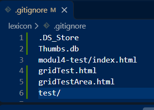

# Webbsida Cafe Kardemumma

_En enkel webbsida som vi ändrat och laborerat med under kursen HTML/CSS/GIT under utbildningen UX/UI frontend hos Lexicon. Sidan är responsiv och innehåller text, bilder och formulär._

## Live-sida

Du kan besöka den färdiga sajten här: https://gitmon-lab.github.io/monika-m4-dag10-github-och-publicering/

## Tekniker som har använts

- HTML
- CSS

 

 

## Gitignore

